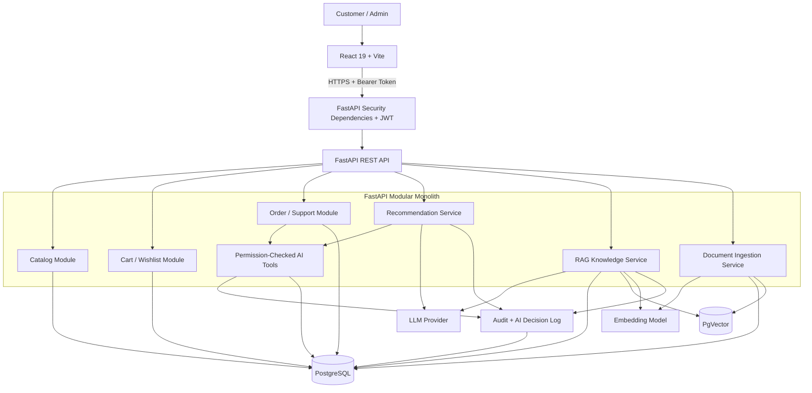
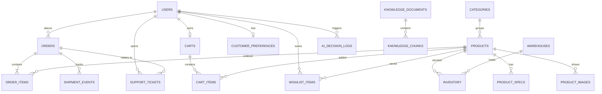

# ShopSmart AI — Product Requirements Document (PRD)

**Document status:** Draft for hackathon implementation  
**Product:** ShopSmart AI — Autonomous E-Commerce Assistant Platform  
**Version:** 1.2 (aligned with the ShopSmart use-case brief; backend and AI stack changed to Python + FastAPI)  
**Date:** 2026-10-23  
**Primary stack:** React 19 + Vite, Python + FastAPI, PostgreSQL + PgVector

---

## 1. Executive Summary

ShopSmart AI is a focused, AI-assisted e-commerce application that helps customers discover products, receive explainable recommendations, understand approved shopping policies, track simulated orders, and contact support. It combines a conventional transactional backend with AI features while keeping authorization, data validation, and consequential business operations under deterministic backend control.

For the hackathon, the team will implement a **modular monolith** rather than microservices. This minimizes deployment and coordination overhead while preserving clear module boundaries. The solution will use synthetic product, customer, order, and policy data. Real payment processing and real shipment-provider integrations are out of scope.

The project is selected over LoanLens AI and RetailPulse AI because its product catalog and shopping workflows are straightforward to seed and demonstrate, while recommendations and retrieval-augmented generation (RAG) still provide meaningful AI and system-design depth. This is a planning judgment, not a claim from the source brief.

## 2. Source Requirements and Planning Decisions

### 2.1 Requirements from the ShopSmart use-case brief

The brief describes an e-commerce assistant that should:

- Understand customer shopping intent.
- Recommend products and explain the recommendations.
- Answer questions using approved enterprise knowledge documents through RAG.
- Track orders and shipment status.
- Coordinate business operations through AI agents.
- Provide explainable and auditable AI decisions.
- Provide product catalog, category hierarchy, search, filtering, sorting, pagination, product comparison, wishlist, cart, customer preferences, customer login, and responsive UI.
- Model each product with ID, name, category, brand, description, price, rating, stock availability, and images.
- Return AI recommendations in the brief's response shape: `interpretedRequirement`, `budget`, `recommendations[]` (each with `productId`, `productName`, `reason`, `availability`), and `clarifyingQuestion`.
- Support document upload/ingestion for PDF, Markdown, and JSON; chunking, embeddings, vector search, retrieval, grounded answer generation, source metadata, and safe behavior when evidence is missing.
- Knowledge documents carry version, effective date, category, and region; customers belong to membership tiers Basic, Prime, or Premium.
- Return knowledge answers in the brief's response shape: `answer`, `confidence`, `sources[]` (document, section, version), and `followUpRequired`.
- Use synthetic/sample data where appropriate; payment processing is out of scope and orders/delivery events may be simulated.
- Provide a working application/source code, architecture and solution overview, setup instructions, live demonstration, proper schema design, validation and error handling, and clean folder structure.
- The brief lists a recommended (not mandatory) stack of React 19 + Vite, Java + Spring Boot 3 + Spring AI, and PostgreSQL + PgVector, and allows any approved AI model. This PRD keeps React, PostgreSQL, and PgVector and replaces the Java backend with Python + FastAPI (see Section 2.2).

### 2.2 Implementation decisions for the hackathon

The following are project decisions made to keep the build feasible. They are not explicit requirements from the brief:

- Build a modular monolith with one FastAPI application.
- Use Python 3.12+ and FastAPI for the backend and AI services. This deviates from the brief's recommended Java/Spring stack, so confirm with the organizers that the recommended stack is not a hard requirement. React 19 + Vite, PostgreSQL, and PgVector stay as recommended.
- Implement customer and admin roles first; add a support-agent role only if needed.
- Prioritize product discovery, AI recommendations, RAG, and a small order/support workflow.
- Use JWT bearer-token authentication for a stateless API, provided the implementation is configured correctly.
- Use Alembic migrations and deterministic seed scripts.
- Use a small set of narrowly scoped, permission-checked AI tools rather than a complex autonomous multi-agent framework.
- Defer real payments, real logistics integrations, microservices, Kafka, Kubernetes, and advanced demand forecasting.
- Treat every feature the brief lists as a functional requirement (comparison, wishlist, customer preferences, login, and so on) as P0. Only additions beyond the brief are P1/P2.
- Use USD ($) for demo prices, matching the brief's example ("under $1000"). Currency is stored per product, so it can be changed later.
- The five-day plan in Section 16 is an estimate, not a guarantee. Rescale it to the hackathon's actual duration and team size.

### 2.3 Requirement coverage matrix

| Brief requirement | PRD section | Priority | Notes |
|---|---|---|---|
| Catalog, category hierarchy, search, filter, sort, pagination | 6.1 | P0 | Server-side only |
| Product comparison | 6.1 | P0 | 2–4 products side by side |
| Cart, wishlist, customer preferences | 6.2 | P0 | Scoped to the authenticated user |
| Customer login, responsive UI | 6.7, 14 | P0 | Seeded users across all tiers |
| Product images, brand, rating, stock availability | 6.1, 9 | P0 | `product_images`, derived availability |
| AI shopping assistant in the brief's response shape | 6.3 | P0 | Includes `budget` and `productName` |
| RAG over PDF, Markdown, JSON with chunking and embeddings | 6.4, 10 | P0 | |
| Sources (document, section, version) and safe fallback | 6.4 | P0 | |
| Membership tiers (Basic, Prime, Premium) | 5, 9 | P0 | Tier-based retrieval filtering is P1 |
| Order and shipment tracking (simulated) | 6.5 | P0 | |
| Coordinating operations through AI agents | 6.6 | P0 (narrow) | One orchestrator, three tools. Multi-agent operations, demand forecasting and promotions are deferred. |
| Explainable and auditable AI decisions | 6.8, 9 | P0 | `ai_decision_logs` and `audit_events` |
| Deliverables (app, diagram, setup, demo, schema, validation, structure) | 15, 17 | P0 | |

---

## 3. Problem Statement

Customers can struggle to find the right product among many options, understand product and delivery policies, and receive timely support. Conventional search and static FAQ pages may not adequately interpret natural-language requirements or connect policy answers to their source documents.

ShopSmart AI will offer a single interface for:
1. Discovering and comparing products.
2. Describing a shopping need in natural language and receiving recommendations grounded in the actual catalog.
3. Asking policy questions and receiving answers supported by approved documents.
4. Viewing simulated order/shipment updates.
5. Creating support tickets through a controlled workflow.

## 4. Goals and Non-Goals

### 4.1 Goals

1. Deliver a working, responsive full-stack e-commerce demo.
2. Provide catalog search, filters, sorting, pagination, product details, comparison, wishlist, and cart.
3. Convert natural-language shopping requests into structured requirements and recommendations tied to real catalog records.
4. Provide RAG-based answers with source title, section, and version.
5. Safely decline or ask a follow-up when evidence is insufficient.
6. Provide simulated order tracking and a basic support-ticket workflow.
7. Enforce authentication, role-based access, object-level ownership checks, input validation, and audit logging.
8. Include reproducible setup instructions, schema migrations, seed data, tests, API documentation, and a demo prompt list.

### 4.2 Non-goals

- Real payment processing or storage of payment card data.
- Integration with real carriers or live shipment providers.
- Production-scale inventory optimization, forecasting, or promotion optimization.
- A full Amazon-scale marketplace or real seller onboarding.
- Microservices or distributed infrastructure.
- Autonomous refunds, order cancellations, or other consequential actions without an explicit authorization/confirmation workflow.
- Using the LLM as a source of truth for prices, stock, policy terms, authorization, or database state.

## 5. Users and Roles

### 5.1 Customer

Can:
- Browse, search, filter, sort, and compare active products.
- View product details and availability.
- Manage their own cart, wishlist, and preferences.
- Ask for AI product recommendations.
- Ask policy questions.
- View only their own orders and shipment events.
- Create and view their own support tickets.

### 5.2 Admin

Can:
- Create/update catalog products and categories.
- Upload and publish approved knowledge documents.
- View document metadata and versions.
- Manage support tickets and simulated shipment events where authorized.
- Review relevant audit events.

### 5.3 Optional Support Agent

May be added if the team needs a separate support role. Permissions must be limited to assigned support operations and must not imply unrestricted admin access.

**Authorization principle:** roles determine the types of operations a user may perform; ownership checks determine which specific records the user may access. Hiding a UI control is not a security boundary.

---

## 6. Scope and Functional Requirements

Priority labels: **P0** = required for the core demo; **P1** = important if time permits; **P2** = defer unless the core is complete.

### 6.1 Product Catalog and Discovery

**P0**
- Display active products with name, brand, category, description, price, rating, images, and stock availability (`IN_STOCK`, `LOW_STOCK`, `OUT_OF_STOCK`).
- Provide product detail pages.
- Support search by query and filters such as category, brand, and price range.
- Support sorting and server-side pagination.
- Provide category hierarchy.
- Provide product comparison for 2–4 selected products, showing specifications side by side.
- Return consistent API response structures and validation errors.

**P1**
- Rating filter and "compare from wishlist" shortcut.

**Acceptance criteria**
- Search/filter/sort combinations return only matching active products.
- Pagination metadata is returned by the backend.
- Invalid price ranges are rejected.
- The frontend does not load the full catalog to paginate locally.
- Product IDs and displayed prices come from the database.

### 6.2 Cart and Wishlist

**P0**
- Retrieve the authenticated user's cart.
- Add a product, change quantity, and remove an item.
- Validate positive quantities and product availability according to the demo inventory rules.
- Wishlist add/list/remove.
- Customer preferences such as preferred categories and budget range (stored and editable).

**P1**
- Use stored preferences to pre-fill or bias AI recommendations. Explicit constraints in the user's message always override stored preferences.

**Acceptance criteria**
- Cart data is scoped to the authenticated user.
- Duplicate product lines are handled consistently, preferably by a unique `(cart_id, product_id)` constraint.
- Invalid quantities and nonexistent products produce safe validation errors.
- The client cannot set another user's cart ID as a way to access their data.

### 6.3 AI Product Recommendations

The assistant accepts a natural-language shopping request, extracts structured constraints, queries the actual catalog, and returns recommendations with explanations.

**P0**
- Extract relevant fields such as category/use case, budget, required features, and other stated constraints.
- Validate the model's structured output.
- Search catalog records through normal backend services.
- Return only real products that satisfy hard constraints.
- Explain why each result matches.
- Ask a clarifying question if essential information is missing.

**Example prompt**
> Suggest a laptop under $1,000 for Java development and AI projects.

**Illustrative response**
```json
{
  "interpretedRequirement": "Laptop for Java development and AI learning",
  "budget": 1000,
  "recommendations": [
    {
      "productId": "LAP101",
      "productName": "Dell Inspiron 15",
      "reason": "16GB RAM, Intel i7 processor, SSD storage",
      "availability": "IN_STOCK"
    }
  ],
  "clarifyingQuestion": null
}
```

**Acceptance criteria**
- Every returned `productId` exists in the database.
- Prices and availability are fetched from the database, not invented by the model.
- Recommendations respect hard constraints such as maximum budget.
- If no suitable product exists, the API says so instead of fabricating one.
- The API returns the documented response schema, including `budget` and `productName`. `productName` comes from the database, not the model. `budget` is `null` when the user gives none.
- Each recommendation request is recorded as an AI decision log entry (see Section 6.8).

### 6.4 RAG-Based Knowledge Assistant

The knowledge assistant answers from approved policy documents, such as return, shipping, refund, warranty, membership, and product-manual documents.

**P0**
- Upload and ingest approved PDF, Markdown, and JSON documents (the formats the brief requires). Plain text and CSV are optional extras.
- Extract text and preserve section information where possible.
- Split text into chunks.
- Generate embeddings and store them in PgVector with metadata.
- Retrieve relevant chunks for a question.
- Generate a response grounded in retrieved evidence.
- Return the brief's response contract (below), including source title, section, and version.
- Safely abstain or ask a follow-up when evidence is missing.
- Filter eligible documents by approval status, effective date, region, and product category.

**Response contract**
```json
{
  "answer": "Opened laptops can be returned within 7 days if physical damage is not present.",
  "confidence": "HIGH",
  "sources": [
    { "document": "Laptop Return Policy", "section": "Opened Products", "version": "2026.1" }
  ],
  "followUpRequired": false
}
```
`confidence` is one of `HIGH`, `MEDIUM`, `LOW`. When evidence is insufficient, return `confidence: "LOW"`, `followUpRequired: true`, and an answer stating the policy documents do not support an answer. The example text is illustrative. Real answers must match the seeded documents.

**P1**
- Metadata filtering by document type and customer membership tier.
- Admin document listing and version inspection.
- Document version activation/deactivation.

**Acceptance criteria**
- Responses cite source documents and versions.
- Only approved, applicable documents are eligible for retrieval.
- Documents outside the applicable region/category/tier are excluded when those filters apply.
- Expired or not-yet-effective documents are excluded according to the project's effective-date rules.
- When relevant evidence is insufficient, the assistant explicitly states that it cannot confirm the answer from available policy documents.
- The assistant does not present general model knowledge as official policy.

### 6.5 Orders and Shipment Tracking

**P0**
- Provide simulated orders for seeded customers or allow a demo order to be created.
- Show order details and status.
- Show a timeline of mock shipment events.
- Enforce order ownership.

**P1**
- Admin endpoint to add mock shipment events.
- Simulated order creation from cart items. If implemented, validate stock and decrement inventory in the same transaction, and reject with `409` when stock is insufficient so inventory never goes negative.

**Acceptance criteria**
- A customer can view only their own orders unless an authorized administrative role is used.
- Shipment events are linked to the correct order.
- Status transitions are validated by backend logic.
- The interface labels this as simulated tracking where appropriate.

### 6.6 Customer Support Workflow and AI Tools

Implement a small controlled workflow, not an unrestricted autonomous agent.

**P0**
- Create a support ticket for the authenticated customer.
- List the customer's tickets.
- Provide narrowly scoped tools for:
  - `getOrderStatus`
  - `createSupportTicket`
  - `getReturnPolicy`
- Validate tool inputs and enforce user/role permissions.
- Record tool execution outcomes in audit events.

**P1**
- Admin/support ticket status updates.
- AI-assisted routing or drafting of customer-facing messages.

**Acceptance criteria**
- Tools cannot bypass backend authorization.
- The model cannot execute arbitrary SQL or write arbitrary records.
- Tool calls are bounded by time/call limits.
- Failed and denied tool calls are recorded without logging secrets.
- Consequential operations such as refunds or cancellations are not performed autonomously.

### 6.7 Authentication and Customer Login

The brief assumes customer authentication exists, so the demo needs a login flow over seeded users rather than a full registration system.

**P0**
- Login endpoint that validates credentials and issues a JWT.
- Seeded demo users: at least one admin and one customer per membership tier (Basic, Prime, Premium).
- Current-user endpoint returning email, role, and membership tier.
- Role-based navigation in the UI (admin screens hidden from customers), with the backend remaining the real enforcement point.
- Consistent handling of expired or invalid tokens in the frontend.

**P2**
- Self-service registration.

**Acceptance criteria**
- Wrong credentials return a generic `401` that does not reveal whether the email exists.
- Passwords are stored only as BCrypt hashes.
- The login endpoint is the only public API route besides explicitly allowlisted ones.

### 6.8 Explainability and Audit of AI Decisions

The brief asks for explainable and auditable AI decisions. Tool-call auditing alone does not cover recommendations and policy answers.

**P0**
- For each recommendation request, persist: actor, request ID, interpreted requirement, applied constraints, candidate product IDs, final recommended IDs with reasons, model identifier, and outcome.
- For each knowledge question, persist: actor, request ID, the question, applied metadata filters, retrieved chunk IDs with similarity scores, the returned sources and confidence, model identifier, and outcome (answered or abstained).
- Admin-only endpoint to review these records.

**Acceptance criteria**
- An admin can explain why a given product or answer was returned, using only the stored record.
- Records never contain passwords, tokens, or API keys. Raw prompts and document text are not stored beyond what is needed to explain the decision.
- Ordinary users cannot modify or delete these records.

---

## 7. System Architecture

### 7.1 Architecture style

Use a **modular monolith**: one React frontend, one FastAPI REST backend, and one PostgreSQL database with PgVector. Keep business modules separated by responsibility; do not introduce microservices for the hackathon MVP.



### 7.2 Component responsibilities

| Component | Responsibility |
|---|---|
| React + Vite | Catalog, product details, chat, cart, wishlist, orders, admin document upload |
| FastAPI security dependencies | JWT authentication, role authorization, endpoint security |
| FastAPI routers | HTTP contracts, Pydantic request validation, response status |
| Business services | Catalog, cart, order, support, and document business rules |
| AI integration layer | LLM calls with Pydantic-validated structured output, embeddings, retrieval workflow |
| PostgreSQL | Transactional data and document metadata |
| PgVector | Similarity search over knowledge chunks |
| AI tools | Narrow, permission-checked access to approved backend actions |
| Audit module | Record relevant administrative actions and AI tool outcomes |

### 7.3 Key architectural rules

- The LLM does not directly access SQL or arbitrary database records.
- The backend validates all model-produced structured data.
- Product facts, price, stock, permissions, and order state come from application data, not LLM assertions.
- AI calls are isolated behind services so model providers can be changed with limited impact.
- Use transactions for multi-step cart/order operations.
- Keep controllers thin and business logic in services.

---

## 8. REST API Contract

Base path: `/api/v1`

### 8.0 Authentication

| Method | Endpoint | Purpose |
|---|---|---|
| `POST` | `/auth/login` | Validate credentials and issue a JWT (public) |
| `GET` | `/auth/me` | Current user's email, role, and membership tier |

### 8.1 Catalog

| Method | Endpoint | Purpose |
|---|---|---|
| `GET` | `/products` | Search, filter, sort, paginate products |
| `GET` | `/products/{id}` | Product details |
| `GET` | `/categories` | Category hierarchy |
| `POST` | `/products/compare` | Compare selected products |
| `POST` | `/admin/products` | Create product |
| `PATCH` | `/admin/products/{id}` | Update product |

Example:
```http
GET /api/v1/products?query=laptop&category=electronics&minPrice=500&maxPrice=1000&sort=price_asc&page=0&size=12
```

Use SQLAlchemy `limit`/`offset` queries driven by validated `page` and `size` parameters (with a maximum page size) for server-side pagination.

### 8.2 Cart, wishlist, preferences

| Method | Endpoint | Purpose |
|---|---|---|
| `GET` | `/cart` | Current user's cart |
| `POST` | `/cart/items` | Add cart item |
| `PATCH` | `/cart/items/{itemId}` | Change quantity |
| `DELETE` | `/cart/items/{itemId}` | Remove item |
| `GET` | `/wishlist` | Current user's wishlist |
| `PUT` | `/wishlist/{productId}` | Add product to wishlist |
| `DELETE` | `/wishlist/{productId}` | Remove product from wishlist |
| `GET` | `/preferences` | Retrieve preferences |
| `PUT` | `/preferences` | Update preferences |

The customer identity is derived from the authenticated principal, not trusted from a request body.

### 8.3 AI

| Method | Endpoint | Purpose |
|---|---|---|
| `POST` | `/ai/recommendations` | Structured product recommendations |
| `POST` | `/ai/chat` | Shopping assistant conversation |
| `POST` | `/knowledge/ask` | Ask an approved-policy question |

Example recommendation request:
```json
{
  "message": "Suggest a laptop under $1000 for Java development and AI projects"
}
```

### 8.4 Knowledge administration

| Method | Endpoint | Purpose |
|---|---|---|
| `POST` | `/admin/knowledge/documents` | Upload approved document |
| `GET` | `/admin/knowledge/documents` | List document versions |
| `GET` | `/admin/knowledge/documents/{id}` | Document metadata |

Document-upload endpoints must be admin-only.

### 8.5 Orders and support

| Method | Endpoint | Purpose |
|---|---|---|
| `GET` | `/orders` | Current user's orders |
| `GET` | `/orders/{id}` | Order and shipment details |
| `POST` | `/orders` | Create simulated order |
| `POST` | `/support/tickets` | Create ticket |
| `GET` | `/support/tickets` | Current user's tickets |
| `PATCH` | `/admin/support/tickets/{id}` | Update ticket status |
| `POST` | `/admin/orders/{id}/mock-shipment-event` | Add mock shipment event |

### 8.6 Audit and AI decisions

| Method | Endpoint | Purpose |
|---|---|---|
| `GET` | `/admin/audit/events` | Review audit events (admin only) |
| `GET` | `/admin/audit/ai-decisions` | Review recommendation and knowledge-answer decision records (admin only) |

### 8.7 API conventions

- Use Pydantic schemas for requests and responses rather than returning ORM models directly.
- Validate request bodies, query parameters, and path parameters with Pydantic models and constraints (`Field`, `conint`, `constr`). FastAPI returns `422` for validation failures by default. Either keep `422` or remap it to `400` with a custom exception handler, and document the choice.
- Register global exception handlers (`@app.exception_handler`) and a request-ID middleware.
- Use consistent error responses containing a machine-readable code, safe message, and request/correlation ID.
- Suggested status codes: `400` invalid input, `401` unauthenticated, `403` forbidden, `404` not found, `409` conflict, `500` unexpected server error.
- Never return stack traces or secrets to clients.
- Use FastAPI's built-in OpenAPI schema and Swagger UI (`/docs`) for endpoint testing and demonstration.

---

## 9. Database Design

Use PostgreSQL for relational/transactional data and enable PgVector for embeddings. A separate MongoDB or vector database is not required for this MVP.

### 9.1 Tables and key fields

#### Identity and preferences

**`users`**
- `id` — primary key
- `email` — unique
- `password_hash` or external identity reference
- `role` — `CUSTOMER` or `ADMIN`
- `membership_tier` — `BASIC`, `PRIME`, or `PREMIUM`
- `created_at`

**`customer_preferences`**
- `user_id` — primary key and foreign key to `users`
- `preferred_categories`
- `budget_min`
- `budget_max`
- `updated_at`

#### Catalog

**`categories`**
- `id` — primary key
- `name`
- `parent_id` — nullable self-referencing foreign key

**`products`**
- `id` — primary key
- `sku` — unique
- `name`
- `description`
- `brand`
- `category_id` — foreign key
- `price` — `NUMERIC`, not floating point
- `currency`
- `rating`
- `active`

**`product_specs`**
- `id` — primary key
- `product_id` — foreign key
- `spec_key`
- `spec_value`

**`product_images`**
- `id` — primary key
- `product_id` — foreign key
- `url`
- `alt_text`
- `sort_order`

**`warehouses`**
- `id` — primary key
- `name`
- `location`

**`inventory`**
- `product_id` — foreign key
- `warehouse_id` — foreign key to `warehouses`
- `quantity` — check constraint `quantity >= 0`
- `updated_at`
- Unique constraint on `(product_id, warehouse_id)`

Product availability is derived from total inventory quantity: `IN_STOCK`, `LOW_STOCK` (below a configured threshold), or `OUT_OF_STOCK`.

#### Cart and wishlist

**`carts`**
- `id` — primary key
- `user_id` — foreign key
- `updated_at`

**`cart_items`**
- `id` — primary key
- `cart_id` — foreign key
- `product_id` — foreign key
- `quantity`
- Unique constraint on `(cart_id, product_id)`

**`wishlist_items`**
- `user_id` — foreign key
- `product_id` — foreign key
- `created_at`
- Composite primary key `(user_id, product_id)`

#### Orders and support

**`orders`**
- `id` — primary key
- `user_id` — foreign key
- `status`
- `total_amount`
- `created_at`

**`order_items`**
- `id` — primary key
- `order_id` — foreign key
- `product_id` — foreign key
- `product_name_snapshot`
- `unit_price`
- `quantity`

**`shipment_events`**
- `id` — primary key
- `order_id` — foreign key
- `status`
- `location`
- `event_time`

**`support_tickets`**
- `id` — primary key
- `user_id` — foreign key
- `order_id` — nullable foreign key
- `subject`
- `description`
- `status`
- `created_at`

#### Knowledge and audit

**`knowledge_documents`**
- `id` — primary key
- `title`
- `document_type`
- `version`
- `effective_date`
- `region`
- `category`
- `membership_tier` — nullable; null means the document applies to all tiers
- `status`
- `uploaded_by`

**`knowledge_chunks`**
- `id` — primary key
- `document_id` — foreign key
- `chunk_index`
- `section_title`
- `content`
- `embedding VECTOR(N)`
- `metadata JSONB`

`N` must match the chosen embedding model's output dimension. For example, use `VECTOR(1536)` only if the selected model returns 1,536 dimensions.

**`audit_events`**
- `id` — primary key
- `actor_id`
- `action`
- `resource_type`
- `resource_id`
- `outcome`
- `request_id`
- `created_at`

**`ai_decision_logs`**
- `id` — primary key
- `actor_id` — foreign key to `users`
- `request_id`
- `decision_type` — `RECOMMENDATION` or `KNOWLEDGE_ANSWER`
- `input_summary` — interpreted requirement or question (no secrets)
- `constraints_or_filters` — `JSONB`
- `candidate_ids` — `JSONB` (product IDs or chunk IDs with similarity scores)
- `output_summary` — `JSONB` (returned product IDs/sources, confidence)
- `model_id`
- `outcome` — for example `ANSWERED`, `ABSTAINED`, `NO_MATCH`, `ERROR`
- `created_at`

### 9.2 Relationships



### 9.3 Data integrity and indexing

- Store money using `NUMERIC`.
- Snapshot product names and prices in order items so historical orders remain understandable after catalog changes.
- Use foreign keys, unique constraints, `NOT NULL` constraints, and check constraints where suitable.
- Index catalog fields used for filtering, order owner and creation date, document status/effective date, and common foreign keys.
- Add a vector index when data volume warrants it; exact similarity search may be adequate for a small seed dataset.
- Keep published document versions immutable. Publish a new version rather than silently overwriting a previously published policy.
- Use Alembic for schema migrations and deterministic seed scripts.

---

## 10. AI and RAG Design

### 10.1 Recommendation flow

1. Receive the natural-language request.
2. Use the LLM to extract structured fields such as category, budget, use case, and constraints.
3. Validate the output against a Pydantic schema and handle missing required information.
4. Query the actual catalog using backend services.
5. Filter out products that violate hard constraints.
6. Optionally use the LLM to explain or rank the eligible candidates.
7. Validate returned product IDs and availability.
8. Return recommendations with reasons and any clarifying question.
9. Write an AI decision log entry (Section 6.8).

Steps 6–7 may be combined into a single structured-output model call to reduce latency, provided the backend still validates every returned product ID and constraint.

The LLM is used for language understanding and explanations; ordinary application code handles catalog facts and constraints.

### 10.2 RAG ingestion flow

1. Admin uploads a document and supplies metadata.
2. Validate file type, size, and administrative permission.
3. Extract text.
4. Split the content into section-aware chunks.
5. Generate embeddings.
6. Store chunks, vectors, and metadata.
7. Publish only after ingestion succeeds and the document is approved.

### 10.3 RAG query flow

1. Receive a question and relevant context.
2. Filter to approved documents applicable to audience, region, category, membership tier, and effective date.
3. Retrieve relevant chunks through vector similarity.
4. Check whether retrieved evidence is sufficiently relevant.
5. Generate an answer constrained to the retrieved evidence.
6. Return source title, section, version, and an answer status/confidence.
7. Abstain or ask a follow-up if the evidence is insufficient or contradictory.

Vector similarity alone does not guarantee correctness. Use retrieval thresholds, source attribution, metadata filters, and a safe fallback. Do not present the model's general knowledge as official policy.

**Implementation notes**
- Apply metadata filters (approval status, effective date, region, category, and tier when implemented) inside the vector search, not after retrieval. Otherwise the top-k results can be filled with ineligible chunks.
- Derive `confidence` from retrieval similarity scores and the number of supporting chunks, not from the model's self-assessment.
- Choose one storage approach and document it. Either use a framework vector store (for example LangChain's PGVector or LlamaIndex's PGVectorStore, which manage their own tables) alongside `knowledge_documents` for version and provenance, or maintain the custom `knowledge_chunks` table described in Section 9 using the `pgvector` SQLAlchemy type. The custom table is recommended because metadata filtering stays plain, testable SQL. Do not run both.
- Seed policy documents must contain the answers to the demo questions, including opened-laptop return, refund timeline, Prime delivery benefit, cancellation after shipment, and smartphone warranty.

### 10.4 AI Integration (Python)

Call the chosen LLM and embedding provider through its official Python SDK, or through a thin framework layer such as LangChain or LlamaIndex if the team prefers one. Request structured output against Pydantic schemas and validate every response before using it. Run vector search through `pgvector` with SQLAlchemy. Keep all provider calls behind service interfaces so the provider can be swapped.

- Load provider settings (API keys, model and embedding identifiers) through `pydantic-settings` from environment variables so credentials are never committed to source control.
- Use async provider clients, or run blocking SDK and PDF-parsing calls in a threadpool, so they do not block FastAPI's event loop.
- Set explicit timeouts and a bounded retry policy on every provider call.

---

## 11. Security, Privacy, and Responsible AI

### 11.1 Authentication and authorization

- Use FastAPI's security utilities: an OAuth2 bearer-token dependency that verifies the JWT (for example with PyJWT), plus reusable role-checking dependencies applied per router or endpoint.
- For a stateless bearer-token API, validate JWT signature, issuer, expiration, and audience as applicable.
- If managing passwords locally, store only strong password hashes (e.g. BCrypt), never plaintext passwords.
- Enforce endpoint roles and service-level object ownership checks.
- Derive customer identity from the authenticated principal.
- Explicitly allowlist public endpoints; protect all other API routes by default.
- Configure CORS for known frontend origins.
- Disable CSRF only when the API is genuinely stateless and does not rely on browser cookies that are automatically attached. Cookie-based authentication requires appropriate CSRF protection.

### 11.2 Upload and input security

- Restrict upload size and permitted formats.
- Inspect file content; do not trust the filename extension or client-provided MIME type alone.
- Generate server-side filenames and keep uploaded files outside the public web root.
- Validate query parameters, quantities, prices, IDs, and all tool inputs.
- Use SQLAlchemy ORM expressions or parameterized queries. Never build SQL by string concatenation.
- Avoid logging full prompts or documents if they contain personal or confidential data.

### 11.3 Secrets and audit

- Store API keys and database credentials in environment variables or a secrets manager.
- Never log passwords, bearer tokens, API keys, or unnecessary personal data.
- Record administrative document publication, relevant AI tool calls, denied actions, ticket status changes, and simulated shipment changes.
- Include timestamps, actor identity where available, action, outcome, and correlation ID.
- Prevent ordinary application users from modifying audit records through public endpoints.

### 11.4 Responsible AI guardrails

- Treat customer messages and retrieved document content as untrusted input.
- Do not allow prompts to override authorization or system-level constraints.
- Do not let the LLM directly execute arbitrary SQL or access arbitrary tools.
- Use allowlisted, narrowly scoped tools with validated arguments. Implement tools as an explicit registry of Python functions with Pydantic-validated arguments, and let the orchestrator call only tools in that registry.
- Bound model output size, tool-call count, and request duration.
- Return safe fallbacks when the model fails or policy evidence is missing.
- Ensure recommendation explanations reflect actual catalog features and constraints.
- Avoid presenting AI-generated explanations as guarantees.
- Keep consequential actions such as refunds and cancellations outside autonomous execution unless a separately designed authorization and confirmation flow exists.

---

## 12. Error Handling and Observability

- Use a shared exception model with global FastAPI exception handlers.
- Return safe, stable error messages and a request/correlation ID.
- Distinguish validation, authentication, authorization, not-found, conflict, provider failure, and unexpected server errors.
- Do not expose stack traces or raw provider errors to end users.
- Log request metadata, latency, result, and error category without logging secrets or unnecessary sensitive content.
- Add timeouts and controlled failure handling for LLM and embedding-provider calls.
- If AI services are unavailable, conventional catalog browsing and core transactional features should remain usable.
- Make document-ingestion failures visible to admins and avoid marking incomplete ingestion as published.

---

## 13. Testing Strategy

### 13.1 Catalog and transactional tests

- Search, filter, sort, and pagination combinations.
- Invalid ranges, quantities, IDs, and missing fields.
- Cart ownership and duplicate-item behavior.
- Order total calculation and immutable order-item snapshots.
- Valid and invalid order-status transitions.

### 13.2 Security tests

- Unauthenticated API access is rejected where required.
- Customer cannot read another customer's cart, order, or ticket.
- Customer cannot invoke admin endpoints.
- Unauthorized AI tool calls are denied and logged.
- Upload routes enforce role, file type, and size constraints.

### 13.3 AI and RAG tests

- Recommendation outputs reference existing product IDs and include `budget` and a database-sourced `productName`.
- Each recommendation and knowledge answer produces an AI decision log entry.
- PDF, Markdown, and JSON documents each ingest successfully and produce citable sections.
- Hard budget constraints are respected.
- No-match requests do not fabricate products.
- Policy answers cite the correct source and version.
- Out-of-scope or unsupported policy questions result in safe abstention.
- Expired, unapproved, or inapplicable documents are excluded.
- Provider errors and malformed structured outputs are handled safely.

### 13.4 Demo test prompts

1. “Suggest a laptop under $1,000 for Java development and AI projects.”
2. “Compare these two laptops for programming.”
3. “What is the return period for an opened laptop?”
4. “Can I cancel my order after it has shipped?”
5. “What is the warranty period for this smartphone?”
6. “Show my latest order and shipment timeline.”
7. “Create a support ticket because my order is delayed.”
8. “What is the policy for a category not covered by any uploaded document?” — should trigger a safe fallback.
9. Attempt to access another user's order — should be denied.
10. Attempt to upload a policy document as a customer — should be denied.
11. “What is the refund timeline?”
12. “Does Prime membership include free delivery?”

Seed policy documents must be synthetic examples approved for the demo; test prompts and sample responses must match the actual seeded policy content.

---

## 14. Frontend Requirements

Use React 19 + Vite with reusable components and a small API client layer.

### Primary screens

- Home/catalog page.
- Product detail page.
- Product comparison view.
- Cart and wishlist.
- AI shopping assistant panel/page.
- Knowledge Q&A panel/page with source references.
- Orders and shipment timeline.
- Customer support tickets.
- Admin product management.
- Admin knowledge-document upload and version listing.

### UI principles

- Responsive and usable at desktop and mobile sizes.
- Display loading, empty, success, and error states.
- Keep AI answers visually distinct from cited policy sources.
- Show the product's actual database price and availability.
- Provide clear source links/metadata for RAG responses.
- Do not rely on client-side role checks for security.
- Keep API calls in a shared client layer and handle expired sessions consistently.

---

## 15. Development and Deployment

### 15.1 Technology stack

| Layer | Technology |
|---|---|
| Frontend | React 19, Vite |
| Backend | Python 3.12+, FastAPI, Uvicorn |
| Validation and settings | Pydantic v2, pydantic-settings |
| Data access | SQLAlchemy 2.0 with a PostgreSQL driver (psycopg) |
| AI integration | Provider Python SDK, optionally LangChain or LlamaIndex |
| Database | PostgreSQL |
| Vector search | PgVector (`pgvector` Python package) |
| Database migrations | Alembic |
| Security | FastAPI security dependencies, PyJWT, bcrypt password hashing, or a configured identity provider |
| Document parsing | pypdf or PyMuPDF for PDF, standard parsers for Markdown and JSON, content-type sniffing (for example python-magic) |
| API documentation | FastAPI OpenAPI schema and Swagger UI |
| Testing | pytest, httpx/TestClient, a test PostgreSQL instance with PgVector; frontend test tooling as selected |
| Packaging | Docker Compose for local development/demo |

The brief permits any approved AI model. Select a provider based on availability, structured-output support, embedding support, cost, latency, and hackathon constraints.

### 15.2 Suggested repository structure

```text
shopsmart-ai/
├── frontend/
│   └── src/
│       ├── components/
│       ├── pages/
│       ├── features/
│       │   ├── catalog/
│       │   ├── cart/
│       │   ├── recommendations/
│       │   ├── knowledge/
│       │   └── orders/
│       ├── api/
│       └── hooks/
├── backend/
│   ├── app/
│   │   ├── main.py
│   │   ├── core/              # settings, security, logging, error handlers
│   │   ├── db/                # engine, session, base model
│   │   ├── catalog/           # router, service, repository, models, schemas
│   │   ├── cart/
│   │   ├── orders/
│   │   ├── support/
│   │   ├── recommendations/
│   │   ├── knowledge/         # router, ingestion/, retrieval/, service
│   │   ├── agents/            # tools/, orchestrator/
│   │   ├── audit/
│   │   └── common/
│   ├── alembic/               # migrations
│   ├── tests/
│   └── pyproject.toml
├── database/
│   └── seed/
├── docs/
│   ├── architecture.md
│   └── api-spec.yaml
├── docker-compose.yml
└── README.md
```

### 15.3 Configuration

Document required environment variables in `.env.example` without real secrets. Likely values include database URL/username/password, model provider API key, model identifier, embedding model identifier, JWT signing key (or JWK URL), issuer, and audience configuration, and frontend origin. Exact names depend on the chosen libraries.

Provide instructions for:
1. Starting PostgreSQL with PgVector.
2. Configuring model credentials.
3. Applying Alembic migrations and loading seed data.
4. Creating the Python virtual environment, installing dependencies, and starting the backend with Uvicorn.
5. Starting the frontend.
6. Accessing API documentation (Swagger UI at `/docs`).
7. Running tests.

---

## 16. Five-Day Implementation Plan

This is an estimated plan for five focused development days. It should be adjusted to team size and familiarity with the stack.

### Day 1 — Foundation
- Initialize the FastAPI project (virtual environment, `pyproject.toml`, linting) and the React project.
- Configure PostgreSQL, PgVector, Alembic, and seed data.
- Implement catalog entities, repositories, services, and endpoints.
- Set up login, JWT issuance, role checks, and seeded users covering the admin role and all three membership tiers.

### Day 2 — Shopping
- Implement cart, wishlist, preferences, and product comparison APIs.
- Implement recommendation extraction and catalog-backed candidate selection.
- Build catalog, product details, and cart UI.
- Connect the frontend to actual backend endpoints.

### Day 3 — RAG
- Create synthetic return, shipping, refund, warranty, and membership documents.
- Implement ingestion, section-aware chunking, embeddings, and vector retrieval.
- Add source citations, metadata filters, and safe fallback behavior.
- Build the knowledge Q&A UI.

### Day 4 — Orders, support, and security
- Implement simulated orders and shipment events.
- Implement support tickets and the narrowly scoped AI tools.
- Complete object-level authorization, input validation, and audit events.
- Integrate remaining screens.

### Day 5 — Hardening and demo
- Run integration and authorization tests.
- Fix error handling and edge cases.
- Validate setup on a clean environment.
- Complete architecture documentation, API documentation, seed scripts, and demo prompts.
- Rehearse the live demo.

**Schedule risk:** comparison, wishlist, and preferences are requirements of the brief, so do not cut them first. If the core is behind, defer in this order: AI-assisted ticket routing, the optional support-agent role, admin shipment-event endpoints, simulated order creation from the cart, tier-based retrieval filtering, and preference-biased recommendations. Never compromise catalog correctness, RAG source grounding, or security checks.

---

## 17. Acceptance Criteria and Definition of Done

The MVP is considered demo-ready when:

- [ ] A user can browse, search, filter, sort, and paginate catalog products.
- [ ] Product details show real seeded product information.
- [ ] A user can add and remove items from their own cart.
- [ ] A user can log in, and the UI navigation reflects their role.
- [ ] A user can manage a wishlist and preferences, and compare 2–4 products.
- [ ] Products show images and stock availability.
- [ ] PDF, Markdown, and JSON policy documents can be uploaded and queried.
- [ ] Every recommendation and knowledge answer has a reviewable AI decision log entry.
- [ ] The recommendation assistant extracts requirements and returns only real matching products.
- [ ] Policy questions return grounded answers with source metadata or a safe fallback.
- [ ] A user can view their own simulated orders and shipment events.
- [ ] A user can create and view their own support tickets.
- [ ] Admin-only operations are protected by backend authorization.
- [ ] Object ownership is checked for carts, orders, and tickets.
- [ ] AI tools are allowlisted, validated, permission-checked, and audited.
- [ ] Database migrations and deterministic seed scripts are included.
- [ ] Validation and consistent error handling are implemented.
- [ ] API documentation and setup instructions are complete.
- [ ] The architecture diagram, demo prompts, guardrails note, and known limitations are included.
- [ ] The app starts and can be demonstrated from a clean setup using the documented instructions.

---

## 18. Risks and Mitigations

| Risk | Mitigation |
|---|---|
| LLM invents products or prices | Retrieve candidates from the database and validate every returned ID and constraint |
| RAG gives unsupported policy advice | Filter approved documents, use source references, evaluate evidence, and abstain safely |
| AI provider unavailable or slow | Add timeouts and safe errors; keep catalog features usable without AI |
| Cross-user data exposure | Enforce object-level ownership in backend services and test it |
| Document upload contains unsafe content | Validate uploads, restrict size/types, keep files private, and require approval |
| Scope exceeds hackathon time | Prioritize P0 features; defer optional modules |
| Embedding dimension mismatch | Configure vector dimension from the selected embedding model and test ingestion/query consistency |
| Stale inventory or policy data | Use clear demo data rules, timestamps, effective dates, and immutable document versions |
| Agent performs unauthorized action | Use narrowly scoped tools, explicit authorization, bounded execution, and audit events |
| Blocking LLM, embedding, or PDF-parsing calls stall the FastAPI event loop | Use async clients or run blocking work in a threadpool or background task, and set timeouts |
| Python/FastAPI differs from the brief's recommended Java stack | Confirm with the organizers; keep React, PostgreSQL, and PgVector as recommended |

---

## 19. Known Limitations

- Catalog, customers, orders, inventory, and shipment events use synthetic/demo data.
- Payment processing and real carrier integration are not included.
- Recommendations are advisory and depend on catalog completeness and model behavior.
- RAG answers depend on the quality, versioning, and coverage of uploaded policy documents.
- A similarity score is not a guarantee of factual correctness.
- The demo's JWT setup and infrastructure should not be considered production-ready without a separate security review, key management, operational monitoring, backup/recovery, rate limiting, and deployment hardening.
- The initial support workflow is intentionally narrow and does not authorize autonomous refunds or cancellations.
- The brief mentions customer uncertainty about delivery timelines and shipping costs, and operational pain points such as stock-shortage prediction and promotion management. These are not listed as functional requirements and are not implemented beyond simulated shipment events and the narrow AI tool set.

## 20. Hackathon Demo Narrative

A suggested demonstration sequence:

1. Open the catalog and filter laptops by price.
2. Ask: “Suggest a laptop under $1,000 for Java development and AI projects.”
3. Show that the assistant returns actual products with reasons grounded in catalog fields.
4. Ask a policy question such as “What is the return period for an opened laptop?” and show the source title, section, and version.
5. Ask an unsupported policy question and demonstrate safe abstention.
6. Open a seeded order and show its simulated shipment timeline.
7. Ask the support assistant to create a ticket for a delayed order.
8. Demonstrate that a customer cannot access another user's order and cannot use admin-only upload endpoints.
9. Close with the architecture, database design, audit trail, and responsible-AI guardrails.

Use only demo policy statements that are present in the seeded knowledge documents.

---

## 21. Final Product Decision

**Build ShopSmart AI as a React + FastAPI (Python) modular monolith backed by PostgreSQL + PgVector.**

Prioritize these capabilities in order:

1. Secure catalog APIs and schema.
2. Catalog-backed AI recommendations.
3. RAG answers with citations and safe abstention.
4. Simulated order tracking and support tickets.
5. Authorization tests, auditability, setup instructions, and demo polish.

Use deterministic backend logic for prices, inventory, ownership, and permissions. Use AI for natural-language understanding, retrieval-based answers, and explanations. This separation gives the project a feasible implementation path while retaining meaningful system-design depth for the hackathon.