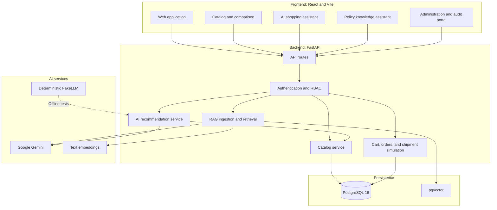

# ShopSmart AI — Autonomous E-Commerce and Intelligence Platform

[](https://www.python.org/)
[](https://fastapi.tiangolo.com/)
[](https://react.dev/)
[](https://vitejs.dev/)
[](https://github.com/pgvector/pgvector)
[](https://www.prisma.io/)
[](https://aistudio.google.com/)
[](https://clerk.com/)
[](LICENSE)

ShopSmart AI is an e-commerce and intelligence platform that combines structured product discovery, AI-assisted recommendations, and a policy question-answering system built with Retrieval-Augmented Generation (RAG). It is designed to keep language-model responses grounded in catalog data and approved policy documents, while making relevant sources and AI decisions traceable.

## Contents

- [Overview](#overview)
- [Features](#features)
- [Architecture](#architecture)
- [Technology Stack](#technology-stack)
- [Repository Structure](#repository-structure)
- [Getting Started](#getting-started)
- [RAG Pipeline](#rag-pipeline)
- [API Reference](#api-reference)
- [Testing and Evaluation](#testing-and-evaluation)
- [Demo Personas](#demo-personas)
- [Interface and Design](#interface-and-design)
- [License](#license)

## Overview

Online shoppers often need to compare many products, understand eligibility and return policies, and get trustworthy answers without being misled by fabricated prices, inventory, or policy details.

ShopSmart AI addresses these needs through a separation between language-model interpretation and application data:

- **Grounded product recommendations:** The model interprets a natural-language request and its constraints; candidate products are selected from the catalog rather than invented by the model.
- **Policy-aware RAG:** PDF, Markdown, and JSON documents are parsed, chunked, embedded, and retrieved from PostgreSQL with pgvector. Answers use retrieved evidence and provide document-level attribution.
- **Commerce workflows:** The platform includes catalog browsing, product comparisons, cart and wishlist interactions, and simulated order and shipment tracking.
- **Auditable AI decisions:** Decision logs record information such as parsed intent, candidates, scores, latency, and retrieved chunk identifiers.

The project includes both a web interface and a modular FastAPI backend, with a local PostgreSQL development environment supported by Docker Compose.

## Features

### Product discovery and comparison

- Browse a categorized product catalog.
- Search, paginate, sort, and filter by attributes such as brand, price, availability, and rating.
- Compare two to four products side by side, including specifications, dimensions, warranty information, and prices.
- Add items to a cart with inventory validation and manage a wishlist.
- View order details and a simulated shipment lifecycle.

### AI shopping assistant

The recommendation endpoint, `POST /api/v1/ai/recommend`, accepts natural-language shopping requirements, such as a budget, desired features, or minimum specifications.

Its structured response can include:

- `interpretedRequirement`: A summary of the customer's request and extracted constraints.
- `budget`: The parsed budget and currency, when provided.
- `recommendations`: Candidate catalog products with reasons tied to product attributes.
- `clarifyingQuestion`: A follow-up question when additional information is needed.

### RAG knowledge and policy assistant

The knowledge engine answers questions using ingested policy documents and supports:

- PDF, Markdown, and JSON document ingestion.
- Text chunking that preserves section context.
- Vector similarity search using pgvector and 768-dimensional text embeddings.
- SQL pre-filtering based on publication status, effective date, region, product category, and membership tier.
- Confidence thresholds and safe abstention when retrieved evidence is insufficient.
- Source attribution containing document title, section, version, and chunk identifiers.

### Authentication, authorization, and auditing

- Clerk JWT bearer-token authentication and claims validation.
- A configurable mock-authentication mode for local development and offline testing.
- Role-based permissions for customers, membership tiers, and administrators.
- Audit records for AI decisions and relevant system events.
- Administrative interfaces for document ingestion and audit inspection.

## Architecture

ShopSmart AI is organized as a React frontend, a modular FastAPI backend, AI and embedding services, and a PostgreSQL persistence layer.



The catalog and order flows use application data for product and transaction state. The RAG service retrieves relevant policy chunks before producing an answer. A deterministic FakeLLM mode is available for offline testing and benchmarking.

## Technology Stack

| Layer | Technologies |
|---|---|
| Frontend | React 19, Vite, React Router, Lucide |
| Styling | Vanilla CSS, Geist and Geist Mono typography, dark and light themes |
| Backend | Python 3.12+, FastAPI, Uvicorn, Pydantic v2 |
| Database | PostgreSQL 16, pgvector |
| Data access | Prisma schema and client, SQLAlchemy Core |
| AI and embeddings | Google Gemini via `google-genai`, 768-dimensional text embeddings, deterministic FakeLLM |
| Authentication | Clerk, JWT bearer tokens, mock-auth mode |
| Background jobs | Inngest |
| Document parsing | pypdf, Markdown heading splitter, JSON parser |
| Testing | pytest, pytest-asyncio, httpx |
| Local infrastructure | Docker Compose |

## Repository Structure

```text
Hack-NullVoid/
├── .env.example
├── docker-compose.yml
├── PRD.md
├── design.md
├── shopsmart-ai-4-hour-plan.md
├── backend/
│   ├── app/
│   │   ├── ai/              # LLM clients, prompts, and grounded schemas
│   │   ├── core/            # Configuration, database, errors, middleware
│   │   ├── models/          # Data and pgvector models
│   │   ├── routers/         # API route controllers
│   │   ├── schemas/         # Pydantic request and response models
│   │   ├── services/        # Catalog, RAG, parsing, and business logic
│   │   └── main.py          # FastAPI application entry point
│   ├── prisma/
│   │   └── schema.prisma
│   ├── scripts/
│   │   ├── seed_products.py
│   │   └── seed_rag_documents.py
│   ├── tests/
│   └── requirements.txt
├── frontend/
│   ├── src/
│   │   ├── api/
│   │   ├── assets/
│   │   ├── components/
│   │   ├── pages/
│   │   └── styles/
│   └── package.json
├── data/
│   └── knowledge_documents/
│       ├── pdf/
│       ├── markdown/
│       └── json/
└── tests/
    └── rag_evaluation.json
```

## Getting Started

Follow these steps to run the platform locally. Run commands from the indicated directories and ensure the database is available before starting the backend.

### Prerequisites

Install the following tools:

- [Docker Desktop](https://www.docker.com/products/docker-desktop/) for PostgreSQL and pgvector.
- [Python 3.12 or later](https://www.python.org/downloads/).
- [Node.js and npm](https://nodejs.org/).
- A Google Gemini API key from [Google AI Studio](https://aistudio.google.com/app/apikey), unless using the fake LLM mode.

### 1. Configure environment variables

From the repository root, copy the example configuration:

**Windows PowerShell**

```powershell
Copy-Item .env.example .env
Copy-Item .env.example backend/.env
```

**Linux or macOS**

```bash
cp .env.example .env
cp .env.example backend/.env
```

Review the generated files and configure values for your environment. Important settings include:

| Variable | Purpose |
|---|---|
| `GEMINI_API_KEY` | API key used for Gemini requests |
| `USE_FAKE_LLM` | Enables deterministic offline mode when set to `true`; use `false` for live Gemini requests |
| `CLERK_MOCK_AUTH` | Enables mock authentication for local development when set to `true` |

For real authentication, configure the Clerk credentials required by the application. Do not commit secrets or populated environment files.

### 2. Start PostgreSQL

Start the database service from the repository root:

```bash
docker-compose up -d db
```

Confirm that the container is running:

```bash
docker ps
```

The configured PostgreSQL service should be available on port `5432`. If your local setup uses different credentials or ports, make sure the backend database connection settings match the Docker Compose configuration.

### 3. Set up the backend

Create and activate a virtual environment.

**Windows PowerShell**

```powershell
cd backend
python -m venv .venv
.\.venv\Scripts\Activate.ps1
```

**Linux or macOS**

```bash
cd backend
python3 -m venv .venv
source .venv/bin/activate
```

Install the Python dependencies:

```bash
pip install -r requirements.txt
```

Apply the Prisma schema to the configured database:

```bash
prisma db push --schema prisma/schema.prisma
```

Seed the product catalog and policy documents:

```bash
python scripts/seed_products.py
python scripts/seed_rag_documents.py
```

Start the development server:

```bash
uvicorn app.main:app --reload --port 8000
```

The backend runs at `http://localhost:8000`. Interactive API documentation is available at `http://localhost:8000/docs`.

### 4. Set up the frontend

Open a separate terminal and navigate to the frontend directory from the repository root:

```bash
cd frontend
npm install
npm run dev
```

Vite will print the local development URL, typically `http://localhost:5173`.

To verify that the production bundle can be generated, run:

```bash
npm run build
```

## RAG Pipeline

The RAG workflow is designed to keep policy answers grounded in versioned documents and applicable metadata.

### Document ingestion

1. **Validate input:** Check file format and content. PDF files are validated using their signature; JSON must parse correctly; Markdown must be valid UTF-8. The documented policy rejects null bytes and files larger than 2 MB.
2. **Preserve versions:** A document title and version pair is unique. Attempting to upload an existing pair returns an HTTP `409 Conflict`.
3. **Chunk content:** Split documents into passages of approximately 800 characters with around 100 characters of overlap, preserving section headings.
4. **Generate embeddings:** Create 768-dimensional vectors for retrieval and store the resulting records in PostgreSQL with pgvector.

### Retrieval and grounded responses

Before ranking chunks by vector similarity, the retrieval process applies metadata constraints:

- Document status must be `PUBLISHED` or `APPROVED`.
- The effective date must be on or before the current date.
- Region, category, and membership-tier filters may further narrow the eligible documents.

The configured similarity levels are:

| Similarity | Interpretation |
|---|---|
| `>= 0.40` | High confidence |
| `>= 0.25` and `< 0.40` | Medium confidence |
| `< 0.25` | Low confidence; abstain rather than generate an unsupported answer |

Answers include available source attribution, such as the document title, section, version, and retrieved chunk IDs. These thresholds are application configuration, not a guarantee that every answer will be correct.

## API Reference

When the backend is running, use the interactive OpenAPI documentation at [http://localhost:8000/docs](http://localhost:8000/docs) to inspect request and response schemas.

| Method | Endpoint | Description | Access |
|---|---|---|---|
| `GET` | `/api/v1/health` | Service health and dependency status | Public |
| `GET` | `/api/v1/products` | Paginated product search with filters and sorting | Public |
| `GET` | `/api/v1/products/{id}` | Product details, specifications, and images | Public |
| `GET` | `/api/v1/categories` | Product category hierarchy | Public |
| `POST` | `/api/v1/ai/recommend` | Natural-language shopping recommendations | Customer |
| `POST` | `/knowledge/ask` | Policy question answering using RAG | Public / Customer |
| `POST` | `/api/v1/admin/knowledge/documents` | Ingest PDF, Markdown, and JSON documents | Admin |
| `GET` | `/api/v1/admin/knowledge/documents` | List ingested documents and chunks | Admin |
| `GET` | `/api/v1/orders` | Customer order history | Customer |
| `GET` | `/api/v1/orders/{id}` | Order details and simulated shipment timeline | Customer |
| `POST` | `/api/v1/cart` | Add a product to the cart with inventory checks | Customer |
| `GET` | `/api/v1/admin/audit/decisions` | Review AI decision and RAG retrieval logs | Admin |

The actual authorization requirements and route prefixes are defined by the running application. Consult the OpenAPI specification for the authoritative contracts.

## Testing and Evaluation

Run the RAG pipeline and evaluation tests from the backend directory:

```bash
python -m pytest tests/test_rag_pipeline.py tests/test_rag_evaluation.py -v
```

The repository includes an 89-case evaluation corpus at `tests/rag_evaluation.json`. The documented benchmark covers:

- Evidence-grounded answers about return windows, warranties, and membership benefits.
- Abstention on out-of-scope or adversarial questions.
- Metadata filtering by membership tier.

The existing project notes report that five test suites passed across the 89 evaluation cases. Run the test commands in your own environment to verify the current result against your checkout and configuration.

## Demo Personas

With `CLERK_MOCK_AUTH=true`, development flows can use mock personas. The application documentation describes selecting a persona in the navigation bar or passing the `X-Mock-User-Id` header.

| Persona | Mock user ID | Tier | Region | Example capabilities |
|---|---|---|---|---|
| Sarah Jenkins | `user_basic` | Basic | US | Standard 14-day return window and standard shipping |
| Marcus Vance | `user_prime` | Prime | US | Extended 30-day return window and free two-day delivery |
| Elena Rostova | `user_vip` | Premium VIP | EU | Extended 60-day return window and complimentary accidental-damage warranty |
| Alex Mercer | `admin_user` | Admin | Global | Catalog administration, policy document ingestion, and audit access |

These personas are intended for development and demonstration, not production identity management.

## Interface and Design

The frontend uses a minimal, editorial visual language inspired by [Wrapper Framer](https://wrapper.framer.ai/). It includes:

- Geist and Geist Mono typography.
- A responsive, asymmetric feature-card layout.
- Product discovery, comparison, and conversational assistant screens.
- Knowledge and administration interfaces.
- Dark and light themes with shared design tokens.
- Interface mockups and visual previews for selected commerce and analytics workflows.

## License

This project was built for the Hack-NullVoid hackathon and is distributed under the [MIT License](LICENSE).
