# ShopSmart AI — 4-Hour Implementation Plan

**Based on:** ShopSmart AI PRD v1.2 (React 19 + Vite · FastAPI · PostgreSQL + PgVector)
**Budget:** 240 minutes of build time, plus a short pre-flight that does not count against the clock
**Goal:** a demo-ready app where every PRD **P0** requirement works as a thin vertical slice

---

## 0. Read this first

**Assumptions**
- One developer working with an AI coding assistant. For a team, give each person a vertical slice (Blocks 1–5) after Block 0.
- Pre-flight (Section 1) is finished *before* the clock starts.
- Synthetic data only. No payments, no carrier integrations (PRD non-goals).

**Honest feasibility note**
The full PRD is about five days of work at normal depth (PRD §16). Four hours only works if each feature is built as the *smallest correct version* and tests cover only the security and AI invariants. Section 3 lists the shortcuts, and each one still satisfies the PRD.

**Rules of the clock**
1. Every block is timeboxed. If a block overruns by more than 5 minutes, apply that block's **Cut** list and move on.
2. Build **backend + UI for one slice together**, then verify, then move on. Do not finish all the backend first.
3. Feature freeze at **3:30**. After that: tests, clean-run check, docs, rehearsal.
4. Spend 2 minutes at the end of each block adding its run/usage notes to `README.md`, so documentation is not a last-minute crunch.

---

## 1. Pre-flight (before the clock starts)

- [ ] Docker running; `pgvector/pgvector:pg16` image pulled
- [ ] Python 3.12+, Node 20+, a working `uv`/`venv`
- [ ] LLM + embedding API key in hand and tested with one curl/SDK call. Note the embedding **output dimension** (this becomes `VECTOR(N)`)
- [ ] Policy documents drafted (Section 5): at least 4 Markdown, 1 JSON, 1 PDF (export one Markdown file to PDF with any tool)
- [ ] Empty repo with the PRD §15.2 top-level folders: `frontend/ backend/ database/seed/ docs/`
- [ ] PRD open next to you; keep §8 (API), §9 (schema), §10 (AI/RAG) handy

---

## 2. Timeline at a glance

```mermaid
gantt
    title 4-hour build (clock time from start)
    dateFormat HH:mm
    axisFormat %H:%M
    section Foundation
    B0 Foundation                    :b0, 00:00, 20m
    section Shopping core
    B1 Auth + Catalog (BE+FE)        :b1, after b0, 35m
    B2 Cart, wishlist, orders, support :b2, after b1, 35m
    section AI
    B3 Recommendations               :b3, after b2, 30m
    B4 RAG knowledge assistant       :b4, after b3, 45m
    B5 AI tools + chat               :b5, after b4, 25m
    section Finish
    B6 Admin, audit, hardening       :b6, after b5, 20m
    B7 Tests, clean run, docs, demo  :b7, after b6, 30m
```

| Block | Clock | Min | Deliverable | Checkpoint |
|---|---|---|---|---|
| **B0** Foundation | 0:00–0:20 | 20 | Repo, DB, all models + one migration, error handling, Vite shell | `/docs` loads, `alembic upgrade head` passes |
| **B1** Auth + Catalog | 0:20–0:55 | 35 | Seed, login/JWT, catalog, compare + UI | Browse/filter/compare as 4 different users |
| **B2** Cart · Wishlist · Prefs · Orders · Support | 0:55–1:30 | 35 | Ownership-scoped CRUD + UI | **1:30 — all non-AI P0 done** |
| **B3** Recommendations | 1:30–2:00 | 30 | `/ai/recommendations` + decision log + UI | Demo prompt #1 returns real products |
| **B4** RAG | 2:00–2:45 | 45 | Ingest PDF/MD/JSON, `/knowledge/ask`, abstention + UI | **2:45 — both AI endpoints work** |
| **B5** AI tools + chat | 2:45–3:10 | 25 | 3 allowlisted tools, `/ai/chat`, audit of calls | Demo prompts #6, #7 work |
| **B6** Admin · Audit · Hardening | 3:10–3:30 | 20 | Admin endpoints/screens, security sweep | **3:30 — feature freeze** |
| **B7** Tests · Clean run · Docs · Rehearsal | 3:30–4:00 | 30 | Passing tests, README, architecture doc, demo run | Fresh-clone start works |

---

## 3. Speed decisions (all PRD-compliant)

| Decision | Why it saves time | PRD ref |
|---|---|---|
| **Sync SQLAlchemy + plain `def` endpoints** | FastAPI runs them in its threadpool, so blocking LLM/PDF calls never stall the event loop, with no async plumbing | §10.4, §18 |
| **One Alembic migration** (autogenerate from all models) + idempotent seed script | Avoids per-feature migration churn | §9.3 |
| **Only the DB runs in Docker Compose**; backend and frontend run locally | No Dockerfile debugging; setup is still documented | §15.3 |
| **Custom `knowledge_chunks` table**, exact cosine search (no vector index) | PRD recommends it; plain SQL filters; tiny dataset | §9.3, §10.3 |
| **Ingestion runs inline on upload** | Small documents; no background worker | §10.2 |
| **Magic-byte checks instead of `python-magic`** (`%PDF-`, JSON parse, UTF-8 decode) | Avoids the libmagic system dependency | §11.2 |
| **`LLMClient` interface + `FakeLLM`** | One swap point for the provider; deterministic tests | §10.4 |
| **Keep FastAPI's default `422`** for validation errors, documented in README | Skips a custom handler | §8.7 |
| **"Expired" = status other than `PUBLISHED`** (`SUPERSEDED` / `INACTIVE`), plus `effective_date <= today` | The schema has no expiry column; this keeps the rule testable. Document it. | §6.4 |
| **Seeded orders instead of `POST /orders`** | PRD allows seeded OR created orders | §6.5 |
| **Plain CSS, no UI library** | No styling decisions; responsive via flex/grid | §14 |

---

## 4. Blocks in detail

### B0 — Foundation (0:00–0:20)

**Backend**
- [ ] `docker-compose.yml`: Postgres with PgVector; `.env.example` (DB URL, LLM key, model IDs, `EMBED_DIM`, JWT secret/issuer/audience, frontend origin)
- [ ] `pyproject.toml` deps: `fastapi uvicorn sqlalchemy psycopg[binary] alembic pydantic-settings pyjwt bcrypt pgvector pypdf python-multipart httpx pytest` + provider SDK
- [ ] `core/`: settings (pydantic-settings), DB session, JWT helpers, **error envelope** `{code, message, requestId}`, request-ID middleware, CORS for the Vite origin, `GET /health`
- [ ] Generate **all SQLAlchemy models from PRD §9.1 in one pass** (including `knowledge_chunks.embedding Vector(EMBED_DIM)`, `ai_decision_logs`, `audit_events`, unique/check constraints)
- [ ] Migration: `CREATE EXTENSION IF NOT EXISTS vector` first, then autogenerate; `alembic upgrade head`

**Frontend**
- [ ] `npm create vite@latest` (React), router, shared `api/client.js` (attaches bearer token, central 401 → logout), auth context

**Exit check:** `docker compose up -d` → migration succeeds → `/docs` and the Vite page both load.
**Cut:** linting/formatting setup; backend/frontend Dockerfiles.

---

### B1 — Auth + Catalog (0:20–0:55)

**Backend**
- [ ] **Seed script** (Section 5): users, categories, products, specs, images, inventory
- [ ] `POST /auth/login` (bcrypt verify; **generic 401**), `GET /auth/me`; JWT with `exp`, `iss`, `aud`
- [ ] Dependencies: `get_current_user`, `require_role("ADMIN")`. Apply auth at **router level** so protection is the default; allowlist only `/auth/login`, `/health`, `/docs`, `/openapi.json`
- [ ] `GET /products`: `query` (name/description/brand), `category` (include descendants), `brand`, `minPrice`/`maxPrice` (reject min > max), `sort`, `page`/`size` (cap `size` at 50), active only, `limit/offset`, returns pagination metadata
- [ ] `GET /products/{id}`, `GET /categories` (tree), `POST /products/compare` (2–4 IDs → specs matrix)
- [ ] Availability derived from summed inventory → `IN_STOCK | LOW_STOCK | OUT_OF_STOCK`
- [ ] `POST /admin/products`, `PATCH /admin/products/{id}` (admin-only; short and basic)

**Frontend**
- [ ] Login page; nav that shows admin links only for `ADMIN` (UX only)
- [ ] Catalog page: search box, category/brand/price filters, sort, **server-side** pagination, availability badge, image
- [ ] Product detail page; compare bar (checkbox on cards, 2–4) → comparison table

**Exit check:** log in as each of the 4 seeded users; filter + sort + paginate; `minPrice > maxPrice` is rejected; compare 3 products.
**Cut:** admin product *UI* (keep the API, demo it in Swagger); category tree → flat dropdown.

---

### B2 — Cart · Wishlist · Preferences · Orders · Support (0:55–1:30)

**Backend** (identity always from the token, never from the body)
- [ ] Cart: `GET /cart`, `POST /cart/items`, `PATCH`/`DELETE /cart/items/{itemId}`. Quantity > 0 and ≤ available stock; duplicate adds merge via the `(cart_id, product_id)` constraint. Item lookups **join through the current user's cart**, so another user's item ID returns 404
- [ ] Wishlist: `GET`, `PUT /wishlist/{productId}` (idempotent), `DELETE`
- [ ] Preferences: `GET`/`PUT /preferences` (preferred categories, budget min/max; validate min ≤ max)
- [ ] Orders: `GET /orders`, `GET /orders/{id}` filtered by `user_id`; **404 for other users' orders**. Include shipment events ordered by time. Seed 3+ orders across 2 users, with events
- [ ] Order status transition map (e.g. `PLACED → SHIPPED → OUT_FOR_DELIVERY → DELIVERED`) as a single function reused later by the admin shipment endpoint
- [ ] Support: `POST /support/tickets` (optional `order_id` must belong to the user), `GET /support/tickets`
- [ ] `audit.record(actor, action, resource_type, resource_id, outcome, request_id)` helper. Call it now for ticket creation, so later blocks just reuse it

**Frontend**
- [ ] Cart page (qty edit/remove, totals computed from DB prices); wishlist page + heart toggle on cards; preferences form
- [ ] Orders list + order detail with shipment timeline, labelled **"Simulated tracking"**
- [ ] Tickets list + create form

**Exit check:** as user B, requesting user A's order returns 404; adding the same product twice yields one line with summed quantity; quantity 0 and unknown product ID return safe validation errors.
**Cut (in order):** `POST /orders` from cart, `POST /admin/orders/{id}/mock-shipment-event`, `PATCH /admin/support/tickets/{id}`.

> **Checkpoint 1:30:** if the non-AI P0 set is not done, stop adding polish and finish it before starting B3.

---

### B3 — AI Recommendations (1:30–2:00)

**Provider layer first (5 min, reused by B4/B5)**
- [ ] `LLMClient` interface: `extract_structured(schema, messages)`, `embed(texts)`. Real implementation with **timeout (~20 s) and bounded retries (2)**. `FakeLLM` returns canned values for tests
- [ ] Pydantic `ShoppingIntent`: `category`, `use_case`, `budget_max`, `required_features[]`, `needs_clarification`, `clarifying_question`

**Flow (PRD §10.1)**
1. [ ] LLM extracts `ShoppingIntent`; validate with Pydantic; on malformed output → safe error + decision log `ERROR`
2. [ ] If essential info is missing (e.g. no category) → return `clarifyingQuestion`, no products
3. [ ] **Catalog query in code**: active, price ≤ budget, category incl. descendants, not `OUT_OF_STOCK`
4. [ ] Deterministic ranking (keyword overlap with specs/use case + rating) → top ≤ 5 candidates
5. [ ] One LLM call to write per-product reasons for the candidates only
6. [ ] **Validate**: drop any returned `productId` not in the candidate set; rebuild each item with `productName` and `availability` **from the database**; if the LLM fails, fall back to templated reasons built from specs
7. [ ] Response exactly as the PRD contract: `interpretedRequirement`, `budget` (`null` if none), `recommendations[]`, `clarifyingQuestion`
8. [ ] No match → empty list plus a `clarifyingQuestion` ("nothing under $X matches, raise the budget?"), never a fabricated product
9. [ ] Write an `ai_decision_logs` row (`RECOMMENDATION`): constraints, candidate IDs, final IDs + reasons, model ID, outcome (`ANSWERED` / `NO_MATCH` / `ERROR`)

**Frontend**
- [ ] Assistant page: input + result cards; for each recommended `productId` fetch `/products/{id}` so **price and stock shown are DB values**; link to product detail; show the clarifying question when present

**Exit check:** demo prompt #1 returns real laptops ≤ $1,000; "laptop under $5" returns none and no invented product; a decision-log row exists for each call.
**Cut:** the LLM reason-writing call (use templated reasons only); preference biasing (P1, already out).

---

### B4 — RAG Knowledge Assistant (2:00–2:45)

**Ingestion — `POST /admin/knowledge/documents` (admin-only)**
- [ ] Multipart upload + metadata: `title`, `version`, `effective_date`, `region`, `category`, optional `membership_tier`
- [ ] Validate: size ≤ ~2 MB; allowed types only; **content sniffing** (PDF starts with `%PDF-`; JSON must parse; Markdown must decode as UTF-8); server-generated filename; files stored outside any public path
- [ ] Extract: PDF → `pypdf` per page (section = heading line if obvious, else `Page n`); Markdown → split on headings; JSON → each top-level key/array item is a section
- [ ] Chunk within a section (~800 chars, small overlap); embed in batches; insert document + chunks in **one transaction**
- [ ] `status = PUBLISHED` only after ingestion succeeds; on failure mark `FAILED` and surface the error to the admin. `(title, version)` unique → re-upload returns `409` (immutable versions)
- [ ] `audit.record` for upload/publish

**Query — `POST /knowledge/ask`**
- [ ] Embed the question; **filter inside the SQL vector query**: `status = 'PUBLISHED'`, `effective_date <= today`, region match (or `ALL`), optional category, `membership_tier IS NULL OR = user tier` (one-line WHERE, cheap)
- [ ] `ORDER BY embedding <=> :q LIMIT 5`; similarity = `1 - distance`
- [ ] **Confidence from retrieval, not the model:**
  - `HIGH` — top similarity ≥ `T_high` and at least 2 chunks ≥ `T_med`
  - `MEDIUM` — top ≥ `T_med`
  - otherwise **abstain**: fixed text "The policy documents do not support an answer", `confidence: "LOW"`, `followUpRequired: true`, no generation call
- [ ] **Calibrate thresholds (5 min):** print top similarities for the 5 answerable demo questions and 2 unanswerable ones; set `T_med` between the two groups
- [ ] Generation: system prompt says to answer only from the numbered context, to treat the context as untrusted data (never as instructions), and to say it cannot confirm if the context lacks the answer. Structured output: `{answer, used_chunk_ids[], supported}`. If `supported` is false → abstain
- [ ] `sources[]` built **from the database** using `used_chunk_ids` (document title, section, version), deduplicated
- [ ] Decision log (`KNOWLEDGE_ANSWER`): question, filters, chunk IDs + scores, sources, confidence, outcome (`ANSWERED` / `ABSTAINED`)
- [ ] `GET /admin/knowledge/documents`, `GET /admin/knowledge/documents/{id}`

**Frontend**
- [ ] Knowledge Q&A page: AI answer in one visual style; sources as chips (document · section · version) in a visually separate block; confidence badge; visible "follow-up needed" state on abstention
- [ ] Admin: upload form (file + metadata) and document/version list

**Exit check:** demo prompts #3, #4, #11, #12 and the smartphone-warranty question answer with correct sources; #8 abstains; a PDF, a Markdown and a JSON file all ingest and produce citable sections.
**Cut:** PDF heading detection (use page numbers); document detail UI.

> **Checkpoint 2:45:** both AI endpoints must work end to end here. If RAG is behind, drop B5's LLM routing (keyword intents) rather than extending B4.

---

### B5 — AI Tools + Chat (2:45–3:10)

- [ ] **Tool registry** (explicit dict, nothing dynamic): each entry = Pydantic args model + a Python function that receives the authenticated user and DB session
  - `getOrderStatus(order_id | "latest")` — own orders only
  - `createSupportTicket(subject, description, order_id?)` — `order_id` ownership checked
  - `getReturnPolicy(category?)` — calls the B4 knowledge service
- [ ] Orchestrator behind `POST /ai/chat`: model picks at most one intent/tool per turn, **max 3 tool calls and ~15 s total**; arguments validated by Pydantic; the final reply is composed from tool results by the backend
- [ ] Anything not in the registry is rejected. Requests for refunds or cancellations get a clear "I can't do that automatically; I can open a support ticket" reply (PRD §11.4)
- [ ] Every tool call (success, denied, failed) → `audit_events` with outcome and **no tokens, keys or full prompts**
- [ ] Response shape: `{reply, toolCalls: [{name, outcome}]}`

**Frontend**
- [ ] A support-assistant chat box on the Orders page; render tool outcomes as small badges

**Exit check:** demo prompts #6 and #7 work; asking the assistant to create a ticket on another user's order is denied and leaves a denied audit row.
**Cut:** LLM routing → keyword intent routing (`"ticket"`, `"order"`, `"return"`); badges UI.

---

### B6 — Admin, Audit, Hardening (3:10–3:30)

- [ ] `GET /admin/audit/events`, `GET /admin/audit/ai-decisions` (admin-only, paginated, read-only)
- [ ] One admin page with tabs: Documents · AI decisions · Audit (Products UI only if already built)
- [ ] **Security sweep**
  - [ ] Every router has an auth dependency; admin routers have `require_role("ADMIN")`; public allowlist is exactly login/health/docs
  - [ ] Ownership enforced in queries for cart, orders, tickets
  - [ ] Error envelope everywhere; no stack traces or raw provider errors returned
  - [ ] CORS restricted to the Vite origin; secrets only from env
  - [ ] No tokens/keys/passwords in logs or audit rows
  - [ ] Upload limits and content sniffing verified manually with a bad file
- [ ] `.env.example` complete

**Cut:** admin tab UIs — demonstrate through Swagger (`/docs`) instead.

> **3:30 — FEATURE FREEZE.** Nothing new after this point.

---

### B7 — Tests, Clean Run, Docs, Rehearsal (3:30–4:00)

| Clock | Task |
|---|---|
| 3:30–3:45 | **Tests** (Section 7) using `FakeLLM`; fix only genuine failures |
| 3:45–3:52 | **Clean-run check:** `docker compose down -v` → up → `alembic upgrade head` → seed → start backend → start frontend → log in → run one demo prompt |
| 3:52–3:58 | **Docs:** finish README (the 7 setup items in PRD §15.3); `docs/architecture.md` = PRD §7 diagram + guardrails note (PRD §11.4) + known limitations (PRD §19) + demo prompts |
| 3:58–4:00 | One quick pass through the demo script (Section 8) |

---

## 5. Seed data spec

| Entity | Minimum |
|---|---|
| **Users** | `admin@…` (ADMIN), plus one CUSTOMER each for `BASIC`, `PRIME`, `PREMIUM`; known demo password in README |
| **Categories** | Electronics → Laptops, Smartphones; plus one unrelated top-level category (e.g. Home) |
| **Products** | ~20: ~8 laptops (some under $1,000 with 16 GB RAM / SSD specs, some over), ~6 smartphones, ~6 other. Each with brand, price (`NUMERIC`), rating, 3–5 specs, 1–2 image URLs, inventory rows covering in-stock, low-stock **and** out-of-stock cases |
| **Orders** | 3+ across two customers with `shipment_events`, including one "delayed" order for demo prompt #7 |
| **Knowledge docs** | The facts below, each with `version`, `effective_date`, `region`, `category` |

**Policy facts to author** (synthetic, so you choose the values, but the answers must exist in the seed documents and the demo must quote only these):

| Demo question | Must be answerable from |
|---|---|
| Return period for an opened laptop | Laptop Return Policy → "Opened Products" (PRD example: 7 days if no physical damage) |
| Refund timeline | Refund Policy |
| Does Prime include free delivery? | Membership Benefits (applies to all tiers, so `membership_tier` null) |
| Cancel an order after it has shipped? | Order Cancellation / Shipping Policy |
| Smartphone warranty period | Warranty Policy |
| *(Unsupported)* a category with no document | **Deliberately no document** (e.g. "gaming consoles") so #8 abstains |

Also seed one **superseded/inactive** document version and one **future-effective** one, so the exclusion tests have something real to test.

Formats: author at least one document each as **PDF, Markdown and JSON** and ingest all three through the upload endpoint (seed script can call the same ingestion service).

---

## 6. Cut ladder (if behind schedule)

Cut **top to bottom**; never cut the "protected" list.

| # | Cut | Block |
|---|---|---|
| 1 | `POST /orders` from cart | B2 |
| 2 | Admin mock-shipment-event endpoint | B2 |
| 3 | Admin ticket status update | B2 |
| 4 | Admin product management UI (API stays) | B1/B6 |
| 5 | LLM reason-writing → templated reasons | B3 |
| 6 | LLM chat routing → keyword routing | B5 |
| 7 | Tier filter in retrieval | B4 |
| 8 | Preference-biased recommendations (already P1) | B3 |
| 9 | Admin audit/decision tab UIs → Swagger | B6 |

**Protected (never cut):** catalog correctness (DB-sourced IDs/prices/stock) · ownership + role checks · RAG grounding and safe abstention · AI decision logs · admin-only upload · compare/wishlist/preferences (brief requirements, so make the UI minimal instead of dropping them).

---

## 7. Must-have tests (~15 min, `pytest` + `FakeLLM` + test DB)

| # | Test | Verifies |
|---|---|---|
| 1 | No token on a protected route → 401; wrong password → generic 401 | AuthN |
| 2 | Customer calls `/admin/*` (upload, audit) → 403 | RBAC |
| 3 | User B reads user A's order → 404 | Ownership |
| 4 | User B modifies user A's cart item → 404 | Ownership |
| 5 | `minPrice > maxPrice` rejected; `size` above cap rejected | Validation |
| 6 | Recommendation: every `productId` exists, `productName` comes from DB, budget respected, `budget` null when absent | AI invariants |
| 7 | No-match request returns an empty list, no fabricated product | AI invariants |
| 8 | Each recommendation and each knowledge answer writes a decision-log row | Auditability |
| 9 | Knowledge: answerable question → correct source + version; unanswerable → `LOW` + `followUpRequired` | RAG |
| 10 | Superseded and future-effective documents are never retrieved | RAG filters |
| 11 | MD, JSON and PDF each ingest and produce chunks with section titles | Ingestion |
| 12 | Tool call against another user's order is denied and audited | AI guardrails |

---

## 8. Demo script (maps to PRD §20)

| Step | Action | Proves |
|---|---|---|
| 1 | Filter laptops by price in the catalog | Server-side search/filter/pagination |
| 2 | Ask: *"Suggest a laptop under $1,000 for Java development and AI projects."* | Catalog-backed recommendations |
| 3 | Open one result; show DB price and stock | Facts come from the DB, not the LLM |
| 4 | Ask: *"What is the return period for an opened laptop?"* | RAG with document · section · version |
| 5 | Ask an unsupported policy question (#8) | Safe abstention |
| 6 | Open a seeded order and its timeline | Simulated tracking |
| 7 | Tell the support assistant: *"My order is delayed, create a ticket."* | Allowlisted tool + audit |
| 8 | As a customer, open another user's order ID; try the admin upload | 404 / 403 |
| 9 | As admin, open AI decisions and audit events | Explainability |
| 10 | Close on the architecture diagram, guardrails, and known limitations | Design depth |

---

## 9. Definition of done (condensed from PRD §17)

- [ ] Browse, search, filter, sort, paginate; product details; images and stock shown *(B1)*
- [ ] Login with role-aware navigation; cart, wishlist, preferences, compare 2–4 *(B1–B2)*
- [ ] Own orders + shipment events; own support tickets *(B2)*
- [ ] Recommendations return only real, constraint-respecting products *(B3)*
- [ ] PDF/MD/JSON upload and grounded answers with sources or safe fallback *(B4)*
- [ ] Allowlisted, validated, permission-checked, audited AI tools *(B5)*
- [ ] Decision log for every recommendation and knowledge answer; admin review endpoints *(B3, B4, B6)*
- [ ] Admin-only operations and object ownership enforced in the backend *(B6)*
- [ ] Migration + deterministic seed script; consistent validation and error handling *(B0–B6)*
- [ ] README setup instructions, API docs at `/docs`, architecture doc, demo prompts, guardrails note, limitations *(B7)*
- [ ] App starts from a clean setup using the documented steps *(B7)*

---

## 10. Risks specific to a 4-hour build

| Risk | Mitigation |
|---|---|
| Embedding dimension doesn't match `VECTOR(N)` | Read `EMBED_DIM` from settings in both the model and migration; run one ingest + query smoke check at the end of B0/B4 |
| LLM key, rate limit or latency problems mid-build | Provider behind `LLMClient`; `FakeLLM` for tests; templated fallbacks for reasons and tool replies |
| Similarity thresholds are guesses | Calibrate with the demo questions (B4), don't pick numbers blindly |
| Demo answers drift from seeded documents | Write the policy facts first (pre-flight) and quote only those in the demo |
| One block eats the schedule | Apply that block's Cut list immediately; use the Section 6 ladder |
| Alembic fails on the `vector` type | Import `pgvector.sqlalchemy.Vector` in the model; create the extension in the migration before tables |
| UI polish consumes time | Plain CSS, one layout, reuse the same card/table components across pages |
| Late discovery of auth gaps | Do the B6 security sweep and the ownership tests *before* any extra polish |
